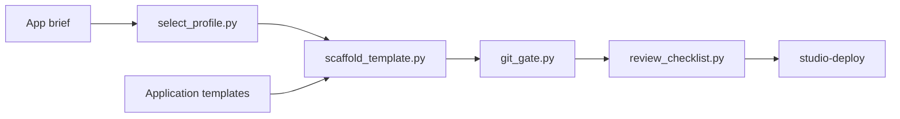

# Cedric's Studio

Personal project by Cedric Durau. I built a small platform for designing, reviewing, and scaffolding applications with coding agents: a fail-closed workflow, a deploy gate that does not trust the app repository, two MCP servers for Obsidian vaults, and the application templates those tools target.

This is private work. Coding agents helped produce parts of it. I directed the design, integrated the pieces, reviewed the results, and kept changing them. It is not employment and it is not a commercial product.

A separate public repository, [llm-bench](https://github.com/cdurau/llm-bench), records reproducible benchmarks of local language models used as coding agents.

The commits from 2026-08-21 through 2026-11-07 are a filtered excerpt of a private repository. Authors and timestamps are original. Commit hashes are not. A few host-specific names in the kept files were replaced with placeholders. Maintenance commits after that date are new work on this excerpt.

No reuse license is granted for my code. Third-party packages keep the licenses in their own metadata. There is no root `LICENSE` file.

## Architecture



The workflow scripts live in [`.hermes/archive/skills/app-builder-workflow/scripts/`](.hermes/archive/skills/app-builder-workflow/scripts). An app brief selects one profile. The scaffold copies that profile into a bounded tree. The git gate accepts only that tree's diff. The review checklist records inspected evidence. `platform/studio-deploy/` is the owner-installed deploy gate and is separate from the app repository.

## Three pieces to read

1. [git_gate.py](.hermes/archive/skills/app-builder-workflow/scripts/git_gate.py) checks the files git actually changed. An executor's own report is not evidence. Secret-shaped lines, unexpected workflows, and path escapes fail closed.
2. [deploy-gate.sh](platform/studio-deploy/deploy-gate.sh) accepts one full commit SHA. Trust paths are fixed at install time. Migration SQL runs only when an approval list matches that commit. The tests use a fake Docker and a fake sudo.
3. [obsidian_mcp/server.py](mcps/obsidian/obsidian-py/src/obsidian_mcp/server.py) and [obsidian-js/src](mcps/obsidian/obsidian-js/src) are two MCP servers over the same idea: read and write Markdown directly, over stdio or streamable HTTP. The Python HTTP path can verify a Cloudflare Access JWT. Tests use fake team and audience values. Neither server ships a vault path.

`select_profile.py` chooses among six profiles: `static-vite`, `react-hono-sqlite`, `react-hono-postgres`, `next-postgres`, `python-fastapi`, and `python-service`. The later Postgres, user-app, and VPS scaffolds are additional templates in this repository.

```bash
cd .hermes/archive/skills/app-builder-workflow/scripts
python3 select_profile.py evaluate --python-needed --backend-needed
```

That command prints a `python-service` decision and the nine brief flags.

## Stack

Python 3.11+ and the standard library for the workflow. TypeScript on Node.js 20+ (the VPS template typechecks on Node 22), Vitest, React 19, Hono, Better Auth 1.7.18, Drizzle, and PostgreSQL in the later templates. MCP over stdio and streamable HTTP. Shell for the deploy gate. Dockerfiles are in the Python MCP server and the templates. This CI does not build images or contact a private network.

## Review and deploy

The git gate bounds a new app to `apps/<slug>/**` plus one deploy workflow. The review checklist forces another review for security boundaries, coupled control planes, and contradictory evidence.

In `platform/studio-deploy/`, placeholders such as `__APP_SLUG__` and `__TRUST_DIR__` are substituted once at install. A leftover placeholder makes the script refuse to run. Environment variables do not move trust paths. Root helpers take no arguments. The suites under `platform/studio-deploy/tests/` build a substituted copy. They do not call a live host.

## Tests

Checked on this tree on 2026-11-07. The root CI workflow [`.github/workflows/ci.yml`](.github/workflows/ci.yml) runs the same commands on GitHub-hosted runners, with `contents: read` and no credentials.

| Command | Result |
| --- | --- |
| `uv run --with pytest --with pyyaml --with jsonschema pytest -q` in the workflow scripts | 375 passed |
| Seven `platform/studio-deploy/tests/*.sh` suites | PASS |
| `uv run pytest` in `mcps/obsidian/obsidian-py` | 30 passed, 1 deprecation warning |
| `npm test` and `npm run build` in `mcps/obsidian/obsidian-js` | 48 passed, bundle written |
| `npm test` and `npm run typecheck` in `templates/vps-app` | 16 passed, typecheck clean |
| `npm test` and `npm run typecheck` in `templates/react-hono-postgres-v2` | 27 passed, typecheck clean |
| `npm test` in `templates/react-hono-postgres-v2-user-app` | 15 passed, 1 skipped |
| `PYTHONPATH=. pytest` in `templates/python-fastapi` and `templates/python-service` | 5 passed and 4 passed |

Integration scripts and image builds were not run. They need a database or Docker. `tests/fake-docker.sh` is a helper, not a suite.

`npm audit` after the dependency update, without taking major upgrades: Obsidian TypeScript MCP 3 (1 moderate, 2 critical), VPS app 8 (6 moderate, 2 critical), React/Hono Postgres v2 8 (6 moderate, 2 critical). The remaining critical findings are Vitest 3 and tinypool, which are test tooling. The fix npm offers is Vitest 5. I did not take that major upgrade. Details are not repeated as a security guarantee: run `npm audit` yourself.

## History

| Month | Kept commits | What changed |
| --- | --- | --- |
| August 2026 | 20 | Profiles, app-brief schema, scaffolding, git gate, review checklist, acceptance checks |
| September 2026 | 34 | Postgres v2 profile, Better Auth user-app, trusted deploy gate, both Obsidian MCP servers |
| October 2026 | 4 | Cloudflare Access JWT checks, then the workflow scripts kept under the archive path |
| November 2026 | 2 | VPS app scaffold on 2026-11-04, and this guide on 2026-11-07 |

One later registry-only commit became empty once both registry names were generalized, so it is not in this history. I did not invent a replacement.

## Run the profile example

From a checkout:

```bash
cd .hermes/archive/skills/app-builder-workflow/scripts
python3 select_profile.py evaluate --python-needed --backend-needed
uv run --with pytest --with pyyaml --with jsonschema pytest -q
```

```bash
cd platform/studio-deploy
bash tests/trusted-path.sh
```

```bash
cd mcps/obsidian/obsidian-py
uv sync --extra dev && uv run pytest
```

```bash
cd mcps/obsidian/obsidian-js
npm ci && npm test && npm run build
```
